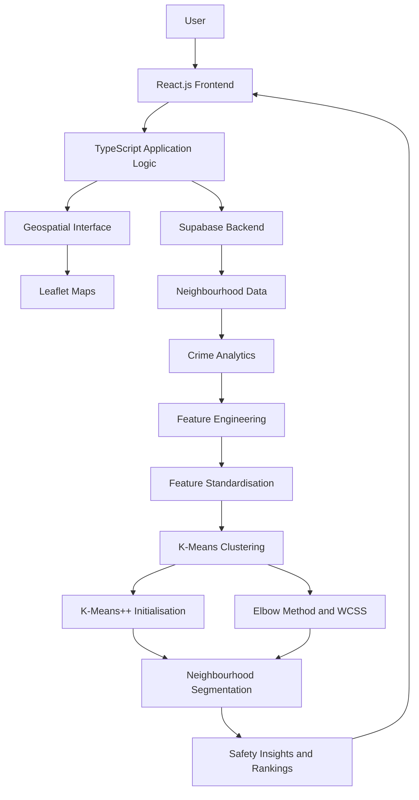
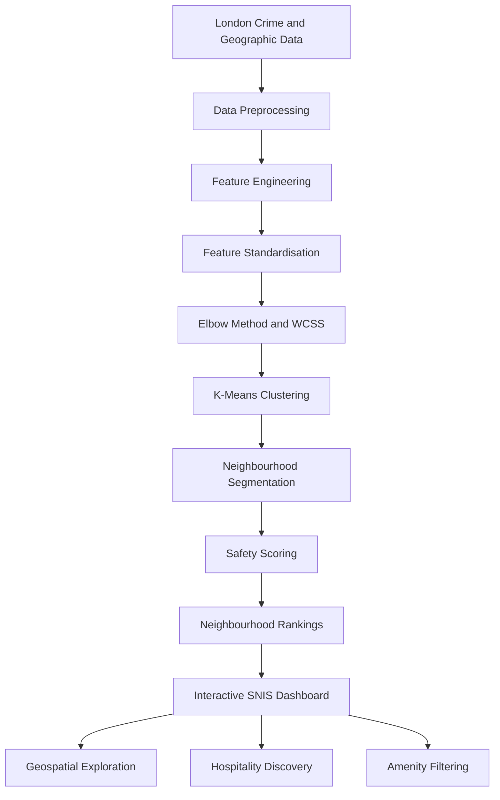

# 🏙️ Smart Neighbourhood Intelligence System (SNIS)
### Data-Driven Neighbourhood Safety Analysis & Geospatial Intelligence Platform

<p align="center">
  <strong>Explore London. Understand Safety. Make Smarter Decisions.</strong>
</p>

<p align="center">
  <a href="https://snis-brown.vercel.app/">Live Demo</a> •
  <a href="#-features">Features</a> •
  <a href="#-machine-learning-methodology">Machine Learning</a> •
  <a href="#-installation-and-setup">Installation</a>
</p>

---

## 📌 Project Overview

The **Smart Neighbourhood Intelligence System (SNIS)** is a data-driven web application designed to analyse neighbourhood safety across London using crime analytics, machine learning, geospatial intelligence, and interactive visualisation.

Choosing a neighbourhood involves considering several factors, including crime patterns, environmental characteristics, nearby hospitality establishments, and the availability of essential amenities. However, this information is often distributed across different sources, making it difficult for individuals to compare neighbourhoods effectively.

SNIS addresses this challenge by bringing neighbourhood intelligence into a unified interactive platform.

The application processes crime-related data, performs feature engineering, applies machine learning-based clustering, and generates neighbourhood safety assessments. Users can explore London geographically, compare neighbourhoods, discover hospitality services within a custom radius, and gain insights into different neighbourhood characteristics.

### 🎯 Project Objectives

- Analyse crime patterns across London neighbourhoods using structured crime datasets.
- Develop a data-driven approach to neighbourhood safety assessment.
- Apply K-Means clustering to identify neighbourhood segments with similar characteristics.
- Implement K-Means++ initialisation to improve clustering initialisation.
- Use feature standardisation to ensure comparable contributions from numerical variables.
- Determine an appropriate number of clusters using the Elbow Method and Within-Cluster Sum of Squares (WCSS).
- Integrate geospatial visualisation for interactive neighbourhood exploration.
- Enable users to discover nearby hospitality establishments using custom search radii.
- Provide safety rankings, amenity filtering, and community-oriented neighbourhood insights.

### 🌐 Live Application

**Live Website:** https://snis-brown.vercel.app/

---

## ✨ Features

### 1. Neighbourhood Safety Assessment

SNIS provides a data-driven approach to evaluating neighbourhood safety.

Key capabilities:

- Crime data analysis across London neighbourhoods.
- Crime-related feature engineering.
- Custom neighbourhood safety scoring.
- Comparative safety rankings.
- Identification of neighbourhoods with different safety characteristics.
- Data-driven insights to support neighbourhood exploration.

The objective is to transform raw crime information into more understandable neighbourhood-level insights.

### 2. Machine Learning-Based Neighbourhood Segmentation

The application uses the K-Means clustering algorithm to group neighbourhoods according to their numerical characteristics.

Implemented techniques:

- Custom K-Means clustering implementation.
- K-Means++ centroid initialisation.
- Feature standardisation.
- Euclidean distance-based cluster assignment.
- Iterative centroid updates.
- Elbow Method for cluster selection.
- WCSS-based clustering evaluation.

The resulting clusters help identify groups of neighbourhoods with similar characteristics.

### 3. Interactive Geospatial Analytics

The platform integrates Leaflet to provide an interactive geographical interface for exploring neighbourhoods across London.

Capabilities include:

- Interactive map-based neighbourhood exploration.
- Geographical visualisation of neighbourhood information.
- Custom-radius location discovery.
- Hospitality establishment discovery.
- Amenity filtering.
- Spatial exploration of neighbourhood characteristics.

### 4. Custom-Radius Hospitality Discovery

Users can explore hospitality establishments within a user-defined geographical radius.

The functionality is designed to help users understand the availability of nearby services and establishments.

Key capabilities:

- Define a custom search radius.
- Discover hospitality establishments around a selected location.
- Explore nearby points of interest.
- Filter available amenities.
- Combine geographical exploration with neighbourhood intelligence.

### 5. Safety Rankings and Neighbourhood Comparison

The system provides comparative insights to make neighbourhood characteristics easier to understand.

Users can explore:

- Relative neighbourhood safety rankings.
- Differences between neighbourhood segments.
- Crime-related characteristics.
- Nearby hospitality and amenities.
- Geographical context for neighbourhood exploration.

### 6. Community-Driven Insights

The platform incorporates a community-oriented approach to neighbourhood intelligence.

Its objective is to make neighbourhood exploration more informative by combining analytical information with community-driven insights.

---

## 🧠 Machine Learning Methodology

One of the core components of SNIS is its machine learning-based neighbourhood segmentation system.

The project uses **K-Means clustering** to identify groups of London neighbourhoods with similar numerical characteristics.

### 1. Data Collection

The project uses London crime-related data and neighbourhood/borough information as the foundation for its analytical workflow.

Potential data preparation stages include:

- Loading structured crime datasets.
- Inspecting records and data types.
- Handling missing or inconsistent values.
- Organising crime information geographically.
- Aggregating relevant crime indicators at the required geographical level.
- Preparing numerical features for analysis.

**Primary data context:**
- London crime statistics.
- London borough and geographical information.

### 2. Data Preprocessing

Raw data cannot always be directly used for machine learning.

Therefore, preprocessing is required to prepare the data for analysis.

The workflow includes:

1. Data cleaning.
2. Handling missing values where necessary.
3. Feature selection.
4. Feature engineering.
5. Numerical data preparation.
6. Feature standardisation.

### 3. Feature Engineering

Feature engineering converts raw data into meaningful numerical variables that can be used by the clustering algorithm and safety assessment system.

For SNIS, crime-related characteristics are transformed into analytical features to represent neighbourhood conditions.

The objective is to create a consistent numerical representation of each neighbourhood.

*Note: The exact feature names and aggregation logic should be documented according to the final dataset and implementation.*

### 4. Feature Standardisation

Numerical features can have different measurement scales.

For example, one feature may contain values in the hundreds, while another may contain values between zero and one.

Without standardisation, features with larger numerical ranges can disproportionately influence distance calculations.

SNIS uses feature standardisation before clustering.

The standardisation formula is:

\[
Z = \frac{X-\mu}{\sigma}
\]

Where:

- \(X\) = Original feature value.
- \(\mu\) = Mean of the feature.
- \(\sigma\) = Standard deviation.
- \(Z\) = Standardised feature value.

This allows numerical features to contribute on a more comparable scale.

### 5. K-Means Clustering

K-Means is an unsupervised machine learning algorithm that divides data points into K clusters based on their similarity.

In SNIS, each neighbourhood is represented as a numerical feature vector.

The algorithm groups neighbourhoods based on the distance between their feature vectors and cluster centroids.

**How K-Means works:**

1. Select the number of clusters (K).
2. Initialise K cluster centroids.
3. Calculate the distance between each neighbourhood and the centroids.
4. Assign each neighbourhood to its nearest centroid.
5. Recalculate centroids using the assigned neighbourhoods.
6. Repeat the assignment and update process.
7. Stop when the clustering converges or the stopping condition is reached.

The Euclidean distance is:

\[
d(x,c)=\sqrt{\sum_{j=1}^{n}(x_j-c_j)^2}
\]

Where:

- \(x\) = Neighbourhood feature vector.
- \(c\) = Cluster centroid.
- \(n\) = Number of features.

### 6. K-Means++ Initialisation

Traditional K-Means can produce different results depending on the initial centroid positions.

To improve initial centroid selection, SNIS implements **K-Means++ initialisation**.

K-Means++ selects initial centroids using a distance-based probability approach.

Its general process:

1. Select the first centroid randomly from the dataset.
2. Calculate the squared distance of each data point from its nearest selected centroid.
3. Select the next centroid with probability proportional to its squared distance.
4. Repeat until K initial centroids have been selected.
5. Execute the standard K-Means clustering process.

**Why K-Means++?**

- Improves initial centroid placement.
- Reduces the likelihood of poor initial configurations.
- Often produces better clustering results.
- Helps improve the consistency of clustering performance.

### 7. Elbow Method and WCSS

Selecting the appropriate number of clusters is an important part of K-Means.

SNIS uses the Elbow Method to evaluate different cluster counts.

The method calculates Within-Cluster Sum of Squares (WCSS) for different values of K.

\[
WCSS = \sum_{k=1}^{K}\sum_{x \in C_k}
\|x-\mu_k\|^2
\]

Where:

- \(K\) = Number of clusters.
- \(C_k\) = Data points belonging to cluster k.
- \(x\) = Individual data point.
- \(\mu_k\) = Centroid of cluster k.

**Implementation workflow:**

1. Run K-Means for different values of K.
2. Calculate WCSS for each clustering configuration.
3. Plot the WCSS values against the number of clusters.
4. Identify the elbow point where the reduction in WCSS begins to slow down.
5. Select an appropriate K based on the observed clustering behaviour.

The project evaluates different cluster counts using the Elbow Method (WCSS).

### 8. Neighbourhood Segmentation

After clustering, neighbourhoods are assigned to their respective clusters.

These clusters represent groups of neighbourhoods with similar numerical characteristics.

The resulting segmentation can support:

- Neighbourhood comparison.
- Identification of similar crime profiles.
- Pattern discovery.
- Exploratory geographical analysis.
- Data-driven neighbourhood categorisation.

**Important:** K-Means identifies similarity in the selected features. It does not independently determine whether a neighbourhood is objectively safe or unsafe. Safety interpretation requires examination of the underlying features and scoring methodology.

---

## 📊 Neighbourhood Safety Scoring

SNIS incorporates a custom safety-scoring mechanism to make crime-related information easier to interpret.

The purpose of the scoring system is to convert relevant crime indicators into a comparative neighbourhood assessment.

The general analytical workflow is:

1. Collect crime-related information.
2. Aggregate crime statistics at the relevant geographical level.
3. Perform feature engineering.
4. Apply the project's safety-scoring logic.
5. Generate neighbourhood-level scores.
6. Use the resulting scores for comparative analysis and rankings.

The scoring mechanism is intended to make neighbourhood safety information more accessible to users.

**Implementation note:** Insert the exact scoring formula, feature weights, normalisation approach, and score range from your source code before publishing. Do not assume that a particular weighting formula or score range is implemented unless verified.

---

## 🗺️ Geospatial Intelligence

Geospatial analysis is another major component of SNIS.

The project uses Leaflet to present neighbourhood information through an interactive geographical interface.

### Geospatial Workflow

1. Obtain geographical information for London neighbourhoods.
2. Associate analytical data with the corresponding geographical locations.
3. Display neighbourhood information through the interactive map.
4. Allow users to explore geographical areas.
5. Support location-based hospitality and amenity discovery.
6. Present neighbourhood insights in geographical context.

### Custom-Radius Discovery

The application supports user-defined radius-based hospitality discovery.

The general spatial search workflow involves:

- Selecting a geographical reference point.
- Defining a search radius.
- Identifying nearby hospitality establishments.
- Displaying relevant geographical results.
- Applying amenity filters.

This provides a practical way to understand the surrounding services and amenities of a neighbourhood.

---

## 🏗️ System Architecture

SNIS follows a web application architecture combining a frontend interface, database services, machine learning logic, and geospatial visualisation.

### High-Level Architecture



### Main Components

| Component | Responsibility |
|---|---|
| React.js | Frontend user interface |
| TypeScript | Application logic and type safety |
| Supabase | Backend and database services |
| Leaflet | Interactive geographical maps |
| K-Means | Neighbourhood clustering |
| K-Means++ | Centroid initialisation |
| Standardisation | Numerical feature scaling |
| Elbow Method | Cluster-count evaluation |
| WCSS | Clustering evaluation metric |

---

## 🛠️ Technology Stack

### Frontend Development

| Technology | Purpose |
|---|---|
| React.js | Component-based frontend development |
| TypeScript | Type-safe JavaScript development |
| Leaflet | Interactive maps and geospatial visualisation |

### Backend and Database

| Technology | Purpose |
|---|---|
| Supabase | Backend services and database integration |

### Machine Learning and Analytics

| Technique | Purpose |
|---|---|
| K-Means | Unsupervised neighbourhood segmentation |
| K-Means++ | Improved centroid initialisation |
| Feature Engineering | Transforming raw data into analytical features |
| Feature Standardisation | Scaling numerical features |
| Elbow Method | Selecting an appropriate cluster count |
| WCSS | Evaluating within-cluster variation |
| Safety Scoring | Comparative neighbourhood assessment |

### Deployment

| Technology | Purpose |
|---|---|
| Vercel | Application hosting and deployment |

---

## 📂 Project Structure

The following is a suggested logical structure for documenting the project. Update it to match your actual GitHub repository.

```text
SNIS/
│
├── public/
│   ├── assets/
│   └── images/
│
├── src/
│   │
│   ├── components/
│   │   ├── Navbar/
│   │   ├── Map/
│   │   ├── Dashboard/
│   │   ├── Neighbourhood/
│   │   └── Filters/
│   │
│   ├── pages/
│   │   ├── Home/
│   │   ├── Dashboard/
│   │   └── NeighbourhoodDetails/
│   │
│   ├── services/
│   │   ├── supabase.ts
│   │   └── api.ts
│   │
│   ├── hooks/
│   │
│   ├── utils/
│   │
│   ├── types/
│   │
│   ├── styles/
│   │
│   ├── App.tsx
│   └── main.tsx
│
├── data/
│
├── .env.example
├── .gitignore
├── package.json
├── package-lock.json
├── tsconfig.json
├── vite.config.ts
└── README.md
```

---

## 🚀 Installation and Setup

Follow these steps to run the project locally.

### Prerequisites

Ensure that the following are available:

- Node.js
- npm
- Git
- A Supabase account
- A code editor such as Visual Studio Code

### Step 1: Clone the Repository

```bash
git clone YOUR_GITHUB_REPOSITORY_URL
```

### Step 2: Navigate to the Project Directory

```bash
cd SNIS
```

### Step 3: Install Dependencies

```bash
npm install
```

### Step 4: Configure Environment Variables

Create a `.env` file in the root directory.

Example configuration:

```env
VITE_SUPABASE_URL=your_supabase_project_url
VITE_SUPABASE_ANON_KEY=your_supabase_anon_key
```

Use the actual environment variable names referenced by your source code.

**Security note:** Never upload database passwords, service-role keys, private API keys, or other secrets to GitHub. Public frontend keys should only be used with appropriately configured database permissions and Row Level Security.

### Step 5: Start the Development Server

For a Vite-based project:

```bash
npm run dev
```

Open the local development URL displayed in your terminal.

### Step 6: Build for Production

```bash
npm run build
```

To preview the production build locally:

```bash
npm run preview
```

---

## 🗄️ Database and Backend

SNIS uses Supabase for backend and database integration.

Supabase provides infrastructure for storing and retrieving application data.

The backend is intended to support the application's neighbourhood intelligence features, including the retrieval and management of relevant data.

### Backend Responsibilities

- Database integration.
- Data storage and retrieval.
- Neighbourhood-related information management.
- Application data access.
- Support for frontend functionality.

### Database Documentation

The following information should be documented based on your actual Supabase schema:

- Table names.
- Column names and data types.
- Primary and foreign keys.
- Relationships between tables.
- Geographical identifiers.
- Crime data fields.
- Neighbourhood information.
- Row Level Security policies.

---

## 📚 Data Sources

The project is based on London crime and geographical information.

Relevant source categories include:

| Data | Purpose |
|---|---|
| London Metropolitan Police crime data | Crime-related analysis |
| London borough geographical information | Geographical identification and mapping |
| Hospitality and amenity information | Location discovery |

### Potential Official References

- London Metropolitan Police data: https://data.police.uk/
- London Datastore: https://data.london.gov.uk/
- Supabase documentation: https://supabase.com/docs
- React documentation: https://react.dev/
- Leaflet documentation: https://leafletjs.com/reference.html
- Vercel documentation: https://vercel.com/docs

*Document the exact dataset names, collection dates, licensing conditions, and APIs actually used in the implementation. The reference links above are useful starting points, not a claim that every source is integrated into the application.*

---

## ⚙️ Application Workflow

The overall application workflow can be represented as follows:



---

## 🎯 Key Technical Highlights

The project demonstrates the practical application of several software engineering, data science, and machine learning concepts.

**Data Science**
- Crime data analysis.
- Data preprocessing.
- Feature engineering.
- Statistical analysis.
- Numerical feature standardisation.

**Machine Learning**
- Unsupervised learning.
- Custom K-Means implementation.
- K-Means++ initialisation.
- Centroid-based clustering.
- Elbow Method.
- WCSS-based evaluation.

**Frontend Engineering**
- React component architecture.
- TypeScript.
- Interactive user interfaces.
- Data-driven rendering.

**Geospatial Analytics**
- Interactive geographical maps.
- Neighbourhood-level exploration.
- Radius-based location discovery.
- Hospitality and amenity filtering.

**Backend Engineering**
- Supabase integration.
- Database connectivity.
- Structured data management.

---

## ⚠️ Limitations and Considerations

SNIS is designed as a decision-support and neighbourhood exploration platform, not as a guarantee of personal safety.

Some important considerations:

1. Crime statistics represent reported incidents and may not capture every incident.
2. Historical crime data may not represent current neighbourhood conditions.
3. Safety scores depend on the selected features and scoring methodology.
4. K-Means results depend on feature selection, scaling, and the chosen number of clusters.
5. Cluster membership indicates similarity, not an absolute safety classification.
6. Geographical boundaries and data aggregation can influence analytical results.
7. Hospitality availability and amenity information may change over time.

Users should consider additional factors and current information before making important neighbourhood decisions.

---

## 🔮 Future Enhancements

Potential improvements to the platform include:

- Integration of more real-time crime and public safety datasets.
- Advanced crime trend forecasting.
- Time-based and seasonal crime pattern analysis.
- More advanced clustering techniques such as DBSCAN and hierarchical clustering.
- Explainable AI for understanding neighbourhood safety scores.
- Enhanced geographical heatmaps.
- Improved neighbourhood comparison dashboards.
- Additional amenity categories and location filters.
- More comprehensive community feedback mechanisms.
- Mobile-responsive interface enhancements.
- Automated data refresh and processing pipelines.

---

## 💡 Real-World Applications

SNIS has potential applications in:

- **Residents:** Exploring crime patterns and nearby amenities before selecting a neighbourhood.
- **Students:** Comparing neighbourhood characteristics when looking for accommodation.
- **Working Professionals:** Evaluating geographical areas based on accessibility and safety-related indicators.
- **Researchers:** Exploring geographical crime patterns and neighbourhood segmentation.
- **Urban Planners:** Supporting exploratory analysis of neighbourhood-level characteristics.

---

## 👨‍💻 Author

**Brijesh Parvadiya**

Data Science Engineering | Machine Learning | Data Analytics | Full-Stack Development

Interested in building data-driven applications that combine machine learning, analytics, and software engineering to solve real-world problems.

---

## 🌐 Project Links

- **Live Application:** https://snis-brown.vercel.app/
- **GitHub Repository:** Add your repository URL here.

---

## 📄 License

This project is intended for educational and demonstration purposes.

Add an appropriate open-source license, such as MIT, if you intend to permit reuse and redistribution of the project.

---

<p align="center">
  <strong>Smart Neighbourhood Intelligence System (SNIS)</strong>
  <br/>
  Turning neighbourhood data into meaningful insights.
</p>
